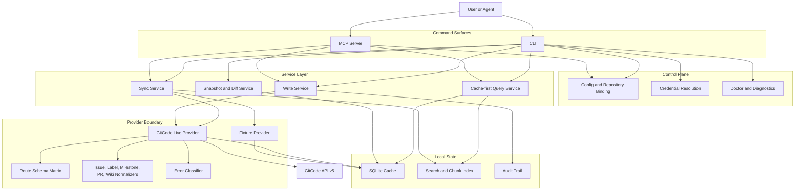

# Component Architecture

This document is the durable component form of the old generated design-package notes. It keeps the architecture and component responsibilities, but drops iteration scaffolding, task ledgers, generated validations, and historical package metadata.

## Runtime Shape

## Component Catalog

| Component | Code Area | Responsibility | Durable Contract |
|---|---|---|---|
| CLI | `cmd/gitcode-mcp/`, `internal/cli/` | Parses commands, resolves startup options, routes reads, sync, writes, config, auth, doctor, and cache commands. | Cache reads remain offline; GitCode-touching lifecycle commands use live provider by default unless `--offline`, `--fixture`, or write `--dry-run` is explicit. |
| MCP server | `internal/mcp/` | Exposes cache-first read tools, sync lifecycle tools, and configured write lifecycle tools to agents. | Tool availability is policy-driven. Write tools use the same service paths as CLI writes. |
| Capability registry | `internal/capability/` | Declares shared operation metadata, surface availability, safety class, and explicit CLI-only/MCP-only exceptions. | New write capabilities should be added through the registry; dangerous or intentionally asymmetric surfaces require a reason and tests. |
| Service layer | `internal/service/` | Owns command use cases, cache orchestration, sync graph commits, write confirmations, snapshots, diffs, and link checks. | Business behavior lives here rather than inside CLI or MCP transports. |
| Local authority contracts | `internal/authority/`, reserved private IPC in `internal/servicectl/` | Defines separate project/entity UUIDs, strict intent, policy preflight, CAS/idempotency DTOs and `authority.v1` negotiation. | Contracts-only/unavailable until the storage/runtime/workflow cohorts are implemented; never promote caches, instantiate credentials or route through GitCode. [Contract and rollout boundary](local-authority-contracts.md). |
| Repository binding | `internal/config/`, `internal/service/` | Maps a stable repo id to owner, repo name, scopes, aliases, API base URL, and cache configuration. | Repository id is the local routing key. Remote ids are aliases, not replacements. |
| Credential resolution | `internal/auth/`, `internal/credential/`, `internal/config/` | Resolves environment and credential-store tokens and reports redacted status. | Tokens never enter logs, docs, fixtures, snapshots, or MCP responses. Missing credentials fail closed for live mode. |
| Doctor and diagnostics | `internal/doctor/`, `internal/diagnostics/` | Reports effective runtime state and normalized failure classes. | Diagnostics are typed and public-safe; raw API bodies and secret material are redacted. |
| Cache store | `internal/cache/` | Persists sources, identities, links, comments, chunks, revisions, sync events, locks, and schema migrations. | Reads are cache-first. Schema versioning and WAL keep routine reads deterministic and concurrent. |
| Repository documentation RAG | `internal/repositorydocs/`, metadata tables in `internal/cache/` | Resolves committed corpus policy, reads exact local Git objects, chunks in memory, publishes immutable revision sets/vectors, and hydrates verified citations. | Git is the only document-byte authority; aliases canonicalize before writes; no fetch and no persistent source/chunk text. |
| Maintenance identity resolution | `internal/servicectl/maintenance.go`, `maintenance_conflicts.go`, Admin controls | Canonicalizes aliases, preserves lossless conflict candidates, renders a generation-fenced selection plan, then atomically promotes one repository authority or one complete physical clone-path cohort behind a cache-writer admission fence. | Distinct repositories never merge across a clone; public surfaces receive paired hashes/fingerprints only; cache paths, repository paths, and config snapshots remain daemon-private. |
| Maintenance coordinator | `internal/servicectl/` | Owns the per-user managed-cache registry, identity validation, head/tail scheduling, job coalescing, and sanitized lifecycle status. | Raw cache paths stay daemon-local; scheduling keys include durable cache UUID and repository. |
| Bounded observation foundations | `internal/observability/` | Keeps catalog-only events and volatile fixed-cardinality metric samples separate from execution authority. | Recording never waits for disk, network, a probe or a telemetry reader; loss and unavailable probes remain explicit. Dedicated UI rollout is a separate cohort. |
| Shared observation reader | `internal/observability/reader.go`, Admin/IPC/CLI/MCP transports | Publishes bounded `observability.v1` summary, metrics, and events from retained authority; validates whole-query cursors and projects safe-copy context. | No broad Admin snapshot, cache bootstrap, credentials, provider probes, sampler start, or hidden execution action. [Transport contract](daemon-observation.md). |
| Indexer | `internal/index/` | Parses markdown, headings, stable ids, links, anchors, chunks, and freshness state. | Indexed chunks carry provenance and citations needed by CLI/MCP reads and snapshots. |
| GitCode provider boundary | `internal/gitcode/` | Defines provider interfaces, fixture behavior, live HTTP adapter, API models, route matrix, pagination, and write confirmation. | Live API shape decisions stay behind this adapter. Fixture mode remains deterministic and network-free. |
| Route schema matrix | `internal/gitcode/route_schema_matrix.go` | Declares supported, deferred, and unsupported route families by product area. | Unsupported or deferred capabilities return explicit diagnostics instead of empty success. |
| Normalizers | `internal/gitcode/*normalizer*.go`, provider model code | Converts GitCode issue, label, milestone, push mirror, pull request, comment, and wiki shapes into cache/service records. | GitCode-specific field quirks and push-mirror credential redaction are handled here, not scattered through transports. |
| Wiki provider | `internal/gitcode/http_client.go` | Traverses `{repo}.wiki` through `/contents`, reads `/raw`, and writes wiki pages through base64 content plus `sha` semantics. | Wiki uses token-compatible API v5 repository routes, not browser-session `web-api` routes. |
| Error classifier | `internal/gitcode/errors.go`, `internal/diagnostics/` | Separates API validation, schema decode, credential/config, transport, rate-limit, and unsupported capability failures. | 4xx API failures, malformed JSON, and network failures must not collapse into generic internal errors. |
| Audit trail | `internal/audit/`, `internal/service/` | Records non-secret write confirmations and idempotency evidence. | Writes are reviewable and replay-safe without storing tokens or raw private payloads. |
| Feedback readiness and setup | `internal/feedback/`, `internal/config/feedback_setup.go`, CLI/MCP/Admin transports | Separates always-available report preparation from submission readiness. Build metadata owns the destination; Admin exposes it read-only with prerequisites and configuration-conflict diagnostics. | Discovery is side-effect-free. Legacy CLI setup enables only the already-bound build destination; matching legacy configuration is accepted, conflicts block submission. Downstream retargeting is build-time only. |
| Test network harness | `internal/testnet/`, package tests, `docs/test-architecture.md` | Provides offline HTTP-compatible test surfaces for live-provider behavior and keeps unit, offline integration, fixture, and live E2E boundaries explicit. | `go test ./...` must pass without real network, credentials, Keychain, or SSH agent. |

## Primary Flows

### Cache-First Read

1. CLI or MCP receives a read request.
2. Repository binding resolves the local repo id.
3. Service layer reads SQLite records, links, chunks, and identities.
4. CLI or MCP returns sanitized records without contacting GitCode.

### Live Sync

1. Caller runs a GitCode-touching lifecycle command; `--live` is accepted as a compatibility alias, while `--offline`/`--fixture` select deterministic fixture mode.
2. Credential and repository binding are resolved before HTTP work starts.
3. Live provider fetches selected collections through GitCode API v5.
4. Normalizers convert remote records into cache graphs.
5. Service layer commits records, comments, identities, links, revisions, and sync events.
6. Index refresh derives chunks and link state for later offline reads.

### Explicit Write

1. Caller invokes a write command or enabled MCP write tool.
2. Service layer validates repo scope, write mode, idempotency, and required fields.
3. Live provider performs the GitCode API call and confirms the remote result. For issue updates it first supplies the canonical preimage to the service's durable claim callback; a changed previously claimed preimage fails before PATCH.
4. Service layer writes audit evidence and updates cache state.
5. CLI or MCP returns a sanitized confirmation. Ambiguous issue-update recovery is GET-only and returns `recovered_after_ambiguous_write` only when requested and preserved-field invariants match.

### Snapshot And Diff

1. Service layer reads cache sources, identities, links, chunks, and revisions.
2. Snapshot export sorts records deterministically.
3. Diff compares two snapshots without live access.
4. Output is safe to review and commit when it uses placeholder data.

## Boundary Rules

- CLI and MCP are transports. Shared behavior belongs in `internal/service/`.
- The daemon publishes its private runtime identity and compatibility PID file
  through same-directory atomic replacement. A reader sees a complete old or
  new document, never a truncate-in-place intermediate. Runtime state remains
  authoritative; the two files are not a cross-file transaction. Malformed
  persistent state is still an error, not silently retried or treated as healthy.
- Live API quirks belong in `internal/gitcode/`, guarded by tests and route-schema evidence.
- Cache migrations must be explicit and versioned. Routine reads should not take the writer lock when the schema is current.
- Writes are never implicit background side effects of reads.
- GitCode wiki files should use explicit `.md` paths for durable pages.
- Historical design-package evidence belongs in git history or wiki summaries, not in main.

## Related Docs

### Event admission isolation

Validated catalog events enter the bounded queue through `TryLock` admission.
An observation reader or writer holding the collector mutex cannot delay an
execution producer: rejected admission increments one atomic pending-loss scalar
without retaining the rejected event. Observation snapshots and asynchronous
checkpoints fold that scalar into dropped-event coverage and the cursor loss
epoch. A previously issued cursor therefore requires a new snapshot after loss;
checkpointed loss survives restart. Production instrumentation never retries
rejected events, and invalid codes or untrusted references do not manufacture
an execution-loss boundary. Close atomically seals and folds pending losses
before shutdown persistence; rejections and delayed producer increments after
that seal cannot alter published coverage or invalidate clean cursors. This
best-effort evidence is not execution authority
and does not promise crash durability before its asynchronous checkpoint.

Execution events use additive schema-1 `phase`, `collection`, `outcome`,
`failure_class`, optional `attempt`, and writer-only `work_kind` fields. Their closed, code-specific
compatibility table is checked before admission and again during replay. Job
admission/terminal, provider-attempt, sync-commit, and retry-admission codes
require resolved opaque correlation; job, commit, and retry codes also require
an opaque job ref.
Terminal outcomes include succeeded, failed, cancelled, interrupted, and
superseded; cancellation, interruption, and supersession carry the matching
finite class rather than an arbitrary owner error string.
Attempt ordinals are bounded to 1024; absent means unknown, not an invented
first attempt. Existing lifecycle records remain valid without these fields,
but cannot carry execution dimensions. Legacy text cannot establish an
execution event. A private context carrier copies resolved refs and a concrete
collector without changing deadlines or cancellation; event details are supplied
at the actual boundary. Daemon construction attaches the collector to the job
owner. Confirmed admission and active-to-terminal transitions copy primitive
identity under the existing job lock; opaque hashing and admission run after
unlocking. Newly dispatched and resumed workers inherit boot/job correlation
from the returned authority value, without another instrumentation job read.
Coalesced admission, failed persistence, repeated terminal updates and snapshot
projection are not new execution events.
If a failed snapshot retains a terminal mutation in memory, its unconfirmed
boundary records ledger loss with `execution_boundary_unconfirmed`; a later
repeat or unrelated snapshot does not invent a confirmed event. A rolled-back
terminal attempt records no ledger loss and a confirmed retry emits normally.
This bounded atomic loss participates in the ledger seal/checkpoint, restart
and cursor-loss boundary, but not the admission-rejection `event_drops` metric.

Actual GitCode and embedding HTTP attempts inherit that context and record one
finite transport outcome after bounded response transfer/body release. This is
not proof of successful JSON decoding or embedding. Pre-transport rejection
records no attempt; ordinals are supplied only by a known policy loop.
Confirmed graph commits mark a concrete one-slot process-local buffer while the
coordinator owns its turn. The service first releases its cache lease; the
coordinator then releases its turn and flushes the buffer exactly once. A scope
mismatch or late confirmation cannot attach to another job or duplicate the
event. Receipt-only recovery emits no new commit. None of this evidence is a
durable execution receipt or a reason to retry work. Observation rejection is
counted as partial coverage and is never retried. These hooks expose no new
transport/UI controls; the full cohort remains gated by remaining O2 hooks,
health qualification and O3-O5 implementation.

`sync_stage_changed` records only new retained batches and confirmed changes of
phase or the actual commit-retry attempt. Its additive opaque `stage_ref` is
valid only on this code; the closed `staging` outcome is staged, waiting_commit,
committing, committed, rejected or superseded. Validated journal identity must
match the existing job/cache/repository/registration context. Idempotent Create,
timestamp-only writes, failed journal writes and read/UI projections emit no
transition. Create records its fresh-retention decision inside the existing
capacity lock and emits after unlocking. A separate one-slot buffer is installed
before the committing journal write and flushed only after the coordinator turn
and service lease are released; failed writes have no confirmed mark to flush.
The buffer retains only opaque refs and finite fields, never an envelope,
payload, blocker, checkpoint, path or terminal-reason bytes. Actual recovered
commit attempts use the same owners. Receipt-only stage reconstruction remains
unobserved at the journal-transition boundary and never invents a fresh provider
attempt or cache commit. Job recovery owners are distinct, as described below.
An accepted journal attempt outside the diagnostic catalog range is never
clamped or rejected by instrumentation. Its confirmed boundary instead records
scope-matched loss and partial coverage; during a commit turn that omission uses
the same one-slot buffer and becomes visible only after release. Loss survives
diagnostic restart without manufacturing a stage event or execution receipt.

`job_recovered` records a confirmed recovery-owner decision: resumed, reconciled
or rejected, with job/boot correlation and a closed rejection class. It carries
no collection, stage ref or fabricated attempt and is not a new admission,
provider attempt, terminal execution outcome or cache commit. Actual resume
owners capture identity/status inside their existing lock and emit after a
confirmed save and unlock. A failed save that retains the memory mutation
records loss, not confirmation; rollback paths emit nothing. Receipt/checkpoint
terminal reconciliation uses a private owner-marked persisted-update path;
generic job projections and repeated recovery never invent this event. Group
rejection captures at most 128 identities under its existing authority lock,
then publishes outside it after the single save. Uncaptured overflow and
retained failed-save boundaries use count-only atomic loss accounting, never an
unbounded diagnostic slice, per-job diagnostic save, extra authority lookup or
retry. These backend hooks remain subject to the O3/O4/O5 rollout gates;
conflict maintenance events use their separate persistence owner below.

`maintenance_state_changed` records a confirmed registration state/class pair
change at enrollment, disable or reconcile persistence owners, not at List,
load, stage projection or timestamp updates. It uses closed before/after enums,
opaque cache/registration/repository refs and collector-owned atomic transition
correlation; it carries no job/stage, attempt, collection, generation, config,
path or error bytes. An operation-local 128-item context buffer captures only
primitive identity and finite fields under the existing registry lock. Nested
owners share it; the outer scheduler/IPC, Admin control receipt or job-action
receipt boundary flushes after all its authority locks unwind. No asynchronous
job retains the buffer. Overflow and retained failed saves record count-only
loss, while rollback and unchanged later replay emit nothing. Existing exact
payload readback confirms an ambiguous atomic write without extra telemetry
I/O. Metrics-only operation counts unconfirmed persistence independently but
does not fabricate overflow for a disabled event sink.

Repository-document transitions use scope `repository_docs` and an event-owned
opaque `source_ref`, distinct for every durably registered source. Their states
are registered, not_indexed, indexing, disabled, ready and degraded; the same
closed failure map and shared capture cap apply. Actual registration/admission,
rebind reset, reconcile completion and retained failure owners observe only a
changed finite pair at their existing save confirmation, qualified against the
originating registration/cache/repository/path and source-generation authority.
An obsolete owner that retains an execution mutation records count-only
unconfirmed loss rather than certifying the replacement source. This observation
guard does not change existing scheduling, mutation, save or return behavior;
unchanged replay does not retroactively confirm or recount the pair. Generation-only rebind,
source replay and inspection-health projection are not extra transitions. Flush
also follows source-generation fences. Source refs are rejected on other events
and cleared from per-worker context. No source path, Git identity, content or
revision enters diagnostics. These hooks do not complete O2 or its O3-O5 gates.

Confirmed conflict resolution uses scope `identity_resolution`, not an ordinary
registration projection. Its event-owned `previous_registration_ref` names the
immutable opaque predecessor, even when that registration is later redirected.
Only identity_conflict, cache_clone_conflict and identity_unresolved are valid
predecessors. Results use the actual final registration state/class, including
residual identity conflicts, config_snapshot_invalid and cache_inspection_timeout;
these extra states do not widen the ordinary registration/source catalogs.
Clone resolution captures each final unique result in the existing result
generation loop after canonicalization, never a provisional selected candidate
or a synthetic single repository. Results of one confirmed operation share fresh
opaque correlation; repeated episodes with the same predecessor remain distinct.

Resolution observations are attempt-local primitive captures sharing the same
128-item logical capacity with earlier registration/source captures. Only the
existing successful save or exact ambiguous-write readback promotes pending
captures and qualified loss to the context carrier. Rollback and panic before
confirmation discard the attempt without erasing earlier evidence. An unchanged
finite pair consumes neither capacity nor loss; unsupported changed results and
over-capacity results report honest count-only loss. Publication follows registry
unlock, job redirect publication and cache mutation fence release. The direct
Admin resolution owner does not introduce an extra control-receipt boundary.
Predecessor refs are forbidden on other events and cleared from worker context;
no candidate, plan, generation, policy, path or source authority enters diagnostics.
Final O2 qualification and the O3-O5 rollout gates remain required.

### Metric evidence foundation

The metric catalog is machine-readable and closed: there is no arbitrary
registration or label API. Dimensions are finite product enums for work kind,
collection, outcome and Admin route class; job, request, cache and repository
identities belong in typed event correlation, never in metric labels.
The foundation does not itself expose new CLI/MCP/Admin endpoints or claim that
the complete observability cohort is ready. Execution hooks, incident projection
and the shared transport/UI rollout have independent integration gates.

Gauges have a 15-second sampling window. Runtime probes report uptime in seconds,
heap allocation in bytes, goroutines as a count and the last observed GC pause
in seconds; no GC observation is unavailable, not a zero pause. Execution probes
supply queued/active jobs, writer waiters, scheduled retries and SSE connections.
Absent, invalid or failed probes produce `value: null` and a fixed reason.
Counters and duration histograms reset at boot and remain unavailable until
their trusted origin is attached. Snapshot `boot_id` and `reset_at` identify
that boundary. Histogram boundaries are 0.01, 0.05, 0.1, 0.5, 1, 5, 15, 60, 300
and 1800 seconds, plus one overflow cell. Distribution cells are non-cumulative;
`count` and `sum` describe the per-boot duration distribution, not proof of work.

Job gauges inspect at most 32,768 authority rows and commit-queue headers under
a successfully acquired execution `TryLock`. Nil and terminal rows count toward
that bound; queue membership is not scanned to obtain its length. Larger job
authorities make all three job gauges unavailable rather than returning partial
counts, pruning execution state or holding the mutex for an unbounded traversal.

The collector attaches a concrete boot-matched atomic origin for `event_drops`.
Current metric snapshots and sampler history read only that scalar, never the
collector mutex or storage. It counts validated admissions rejected by queue
bounds or observation contention; invalid input, post-Close rejection and
replayed prior-boot durable losses are excluded. A storage failure that retains
an event in memory is partial persistence coverage, not an invented admission
drop. Missing attachment stays unavailable. There is no per-entity series or
caller callback, and additive recording cannot overwrite this attached total.
Generic origin registration also cannot make this collector-owned series
available; only the concrete boot-matched attachment supplies its current total.

History is a fixed ring of 60 UTC one-minute buckets, sampled in distinct UTC
15-second slots. Gauge/counter count, sum and extrema summarize sampled values.
Counter delta sums valid adjacent-sample increments; rate is the latest valid
adjacent-sample increment per second, not a cross-boot or whole-minute rate.
Histogram history aggregates observed duration count/sum/extrema between
adjacent samples, assigned to the ending sample's UTC bucket. A sampling gap
does not attribute an arbitrarily long duration interval to the newest minute.
Current per-boot totals remain available separately. Missing buckets,
pre-boot history, unavailable probes and baseline/reset boundaries remain
explicit, without invented zeros. A complete bucket requires all four distinct
slots and no missing baseline/probe/loss evidence. The current in-progress
bucket may be incomplete without being an execution failure.

Instrumentation uses bounded `TryLock` recording and never invokes a supplied
callback. Telemetry contention or invalid input increments a loss counter and
makes the snapshot partial; it cannot change execution results. Sampling probes
run only on a separate cancellation-aware worker. A stalled probe does not block
recording or snapshot reads, and shutdown cannot certify that worker as joined
until it actually exits. Returned catalog, labels, buckets and distribution
arrays are independent copies, not mutable references to the live registry.

The daemon constructs metrics with the collector's immutable boot identity,
attaches the concrete JobManager sink before loading durable jobs, then starts
the sampler after snapshot recovery and before publishing work. Teardown must
join the sampler before the collector can record a clean shutdown. Early
startup failure cannot claim a clean observed boot.

Job admission counts only a newly created, successfully persisted admission;
coalesced requests and reused recovery identities are not new admissions.
Terminal counters count successfully persisted active-to-terminal transitions,
not each progress update or the number of retained terminal jobs. Snapshot
loading and interrupted-to-terminal recovery projections are not execution
outcomes. A failed terminal persistence boundary marks observation loss without
changing the existing job error/rollback behavior. Recording follows execution
lock release and uses only finite work-kind/outcome enums. Sync/RAG duration
histograms are attached with the job origin independently of the confirmed
record/chunk throughput origins. No-start cancellations have an outcome but no
fabricated execution duration.

Job gauges use a non-waiting authority probe: queued jobs are counted separately
from running/cancelling jobs. `writer_waiters` counts only entries behind the
current owner in daemon sync-commit FIFOs, not external OS/SQLite waiters or the
active turn itself. A busy JobManager gives null probe values. This remains
distinct from writer-contention attempt instrumentation and durable incident
health; observing a queue does not repair or admit work.

Collection `retry_admissions` increments on entry into a real re-attempt, not
when its checkpoint is saved, loaded or waiting for a future window. A resumed
retry which actually executes counts in the new boot; receipt-only recovery
does not. Cancellation before admission and failed checkpoint persistence do
not invent retries. Typed writer denials are counted at daemon admission,
sync-commit reservation and execution-result boundaries, after releasing job
locks and commit turns. Normal FIFO queueing, coalescing, identity/recovery
fences and raw error messages are not writer contention. Internal adapter
errors are not also counted at the cache layer. Direct local writers use the
finite `other` work kind, never their operation/id as a label.

Those same typed-denial owners emit `writer_contended` with `phase: writer`,
`outcome: denied`, `failure_class: writer_busy` and one of `sync`, `rag`,
`repository_docs`, or `other`. Worker events inherit their private job context;
resumed admission copies its validated retained identity under the existing job
lock. Pre-admission/direct denials have no fabricated job ref: they use only
already resolved cache/repository refs and a fixed boot/work-kind correlation
scope, not a request identity. Recording happens outside job locks, commit turns
and cache leases, without new authority lookups. Metrics are optional and loss
is not retried through another collector binding. The closed dimensions are
validated again on replay; typed error bodies and blocker ids never cross this
boundary.

The same actual retry-entry boundary emits `retry_admitted` with `phase: retry`,
`outcome: admitted`, a known collection and bounded ordinal from 2 through 1024.
It inherits the job's opaque boot correlation even without a metrics sink.
Timers, checkpoint writes, cancelled waits and the first attempt emit no retry
admission. Unknown collections/ordinals cannot become event dimensions; the
existing counter's fixed `other` bucket remains separate diagnostic evidence.
An actual retry outside those catalog bounds, including an accepted retained
ordinal, contributes count-only ledger loss when its inherited worker scope is
valid. It never clamps the execution ordinal or fabricates an event; malformed
or absent scopes, non-attempts and cancelled waits contribute no phantom loss.
Lossy event admission never retries or changes the actual scheduler operation.

`retry_scheduled` samples durable pending collection/commit waits and enabled
maintenance backoff windows, including due windows not yet admitted. Active
work suppresses its registry's previous backoff projection; a collection and
commit-stage projection for the same waiting collection count once. Canonical
repository-document source windows replace, rather than add to, their legacy
single-source summary. Terminal job snapshots, disabled stages/registrations
and ordinary periodic polls are not scheduled retries. The registry/job probe
uses try-only locks over both authorities and returns null if either is busy;
it never starts work, reads disk or infers retry state from event counts.
Cancelled/superseded maintenance stages and current-authority source admission
tombstones suppress backoff, including the legacy source projection. A current
physical-authority admission takes precedence over a legacy tombstone; another
physical authority's cancellation does not apply.

Execution health is a separate read-only projection of retained durable jobs,
collection outcomes, maintenance/frontier state and canonical source stages.
It accepts only fixed signal/reason enums and internally resolved opaque refs;
no raw error, progress text, provider payload or counter is evidence of success.
Up to 128 incident cohorts are returned, active first then newest; omitted
cohorts are counted and history becomes partial without hiding the overall
active-failure count. First/last observations, last success and retry deadlines
use authority timestamps, not polling time. A strictly later confirmed success
recovers an incident; equal timestamps do not prove recovery order. Restart and
repeated reads reconstruct the same retained evidence, not new execution.
History explicitly covers retained authority, not pruned jobs or unobserved
work. Busy/missing authority and the 32768-input projection cap produce unknown
health, not healthy empty history. Authority inspection itself uses that same
32768-item work budget, including inactive/empty rows; oversized sources cannot
hold execution locks through an unbounded scan. Grouping/ref construction follows try-only
authority snapshot release. Telemetry/storage readiness remains separate from
execution health; unavailable observation cannot change a durable job outcome.
Collection snapshots cannot hide a later rejected commit stage or whole-job
failure. Retained degraded frontiers contribute their current failure as well
as their preceding success, even when the relevant job has expired. Automatic
configuration/identity blocking remains a fault when it disables admission;
explicit user-disable is not a fault. Missing fault timestamps remain unknown.
Whole-job failure deduplication requires a matching terminal signal, fixed
reason, exact nonempty authority error class and timestamp in the collection
evidence; an older collection problem cannot represent a later checkpoint
rejection. Automatic cache
inspection timeouts and clone conflicts also remain visible admission faults.

Repository-document source inspection has an independent `inspection` health
cohort; indexing jobs/stages have `indexing` phase and cannot recover that
cohort at any timestamp. The existing source registration retains one
fixed-size inspection episode: last result/attempt/success, first/last failure
and a closed Git-store/policy/revision-set category. The real reconcile owner
records its completion clock and confirms a registry transaction before
downstream admission/indexing. A failed metadata write preserves the last
confirmed episode with `retention_incomplete`; it does not invent recovery or
change scheduling. Later finish snapshots cannot republish discarded evidence,
and a new confirmed inspection clears incomplete coverage. Registration/source
generation and physical authority must still match at publication. A later
admission error cannot discard an independently confirmed inspection; its
indexing fault remains visible instead of being erased as an aggregate duplicate.
No observation reader performs Git/cache I/O or updates this authority.
Successful inspection is not index readiness or embedding success. Only a
strictly later inspection success recovers the retained episode; a new failure
after recovery begins a new episode, not an unbounded history of all failures.
Legacy/unobserved or inconsistent summary state is explicitly partial/unknown;
recognized current legacy inspection faults remain active with partial history.
An older/equal/newer indexing success cannot hide them. Canonical source maps
replace the singleton projection. Current physical-authority cancellation
tombstones and explicit registration/corpus disable suppress intentionally
inactive work; an old cancelled indexing stage alone is not a cancellation of
a new inspection. Source records share the evidence budget and active-first
128-cohort bound. O3 transport selectors and O4 Admin must expose these phases
before the complete observability cohort is released.

Daemon-owned execution carries the concrete metric sink in a private context
value without changing cancellation or deadlines. GitCode provider attempts
are one actual policy-loop HTTP Client.Do invocation plus its bounded response
transfer, excluding rate-limit waiting, pre-transport validation and sleep
between retries. Each retry is observed separately, including the direct wiki
tree path; a guarded single-attempt request remains single-attempt. This is not
a TCP packet/socket count, redirect-hop count or confirmation of a remote
mutation. Domain JSON decoding after a completed transfer is a separate
execution result. Outcomes use fixed status/typed-error classes: succeeded,
forbidden (including authentication rejection), rate_limited, timeout,
cancelled, invalid transfer/validation or failed. Only the class and duration
cross the observation boundary, never raw request/response data.
Foreground clients without a daemon sink remain unobserved. Incidents and the
remaining execution boundaries retain their own integration gates.

Ollama HTTP attempts use the same finite transport outcome classes and per-boot
provider series. Model listing, native embedding calls, each actual retry and
each one-input legacy fallback request count separately. A fake provider,
empty input, encoding/request-construction failure or pre-cancelled work does
not invent HTTP traffic. Duration ends when transport/response reading completes,
excluding subsequent JSON/vector validation; recording occurs after response
body release. An HTTP-successful response can therefore still yield an invalid
JSON, missing-model or dimension error at the embedding-operation layer. No
input, endpoint, model, credentials or provider error text enters these metrics.

Confirmed sync throughput is recorded at the shared atomic commit boundary,
not inferred from a job, a fetched/staged count or a recovery projection.
`sync_committed` counts successfully committed source graphs by fixed collection:
issue/PR/wiki sources or individual comment sources. Completing one issue-comment
parent queue item with two comments therefore counts two records, not one group
or three staged work units. Queue/frontier-only updates count zero. Rewriting an
unchanged graph in a new actual commit still represents committed processing;
the counter does not claim newly inserted records or changed content. Writer
contention, rejected/cancelled transactions and rollback count zero. A newly
committed recovery batch counts in the current boot; reading an existing commit
receipt without another transaction does not. Recording follows cache writer
lease release; no telemetry-driven cache reads or deduplication store are added.

`rag_embedded` counts only successful vector upserts for missing/stale chunks.
It excludes provider calls, fresh-vector reuse and failed writes. A local scalar
accumulator is flushed after writer lease release on every exit, including
cancellation, a later run/coverage persistence failure or superseded coverage.
Resuming skips already persisted vectors rather than inflating throughput.
These counters remain volatile per-boot evidence; durable receipts and coverage
remain the execution authority. Their availability is attached when the actual
commit/index hook is entered, independently of job admission/duration.

Admin HTTP hooks classify only registered router patterns into the fixed
`session`, `read`, `control`, `search`, `events`, `assets` and `unknown` classes.
Completed handlers record one request outcome and duration outside handler
execution and session locks. A final 4xx is rejected, a 5xx, panic or response
write failure is failed, and a cancelled request is cancelled unless an observed
failure already takes precedence. Metric loss never changes response behavior.
Queries, request bodies, cookies, raw paths, target identities and error text
are not metric dimensions. Explicit handler work inherits the concrete daemon
metric sink without starting additional provider or maintenance work.

The same completion owner emits `admin_request_completed` independently of
metrics. Its closed schema carries only `phase=admin`, finite `admin_route` and
outcome plus opaque correlation. No entity, raw status, error, route, request id,
cookie, body or header is accepted. The concrete collector owns an atomic
boot/request sequence shared across HTTP controllers; browser request ids never
participate. Completion runs after handler/session/control locks unwind and
keeps response, panic, flush and cancellation semantics unchanged. A dropped
event is explicit partial evidence and is never retried. The three registered
observability GET patterns are excluded from event emission, preventing
telemetry polling from appending its own timeline; arbitrary prefix-matching
user paths are not excluded. O3 must retain this exclusion when exposing those
endpoints, and O4/O5 remain the UI/integrated rollout gates.

The SSE connection gauge counts only authenticated, cursor-valid handlers with
actual streaming support. Atomic admission and deferred release cover every
exit, including cancellation and replay recovery. Its request duration is the
stream lifetime, not handshake latency; an open stream has not yet contributed
a completed request. Sampling this gauge invokes no snapshot or provider and
takes no execution/session/event locks. HTTP streaming support and
ResponseController error behavior remain unchanged by the optional wrapper.

- [Architecture](architecture.md)
- [Cache And Sync Model](cache-and-sync-model.md)
- [GitCode API Discovery](gitcode-api-discovery.md)
- [MCP Setup](mcp-setup.md)
- [PR/MR Workflow](pr-mr-workflow.md)
- [Sanitization Rules](sanitization.md)
