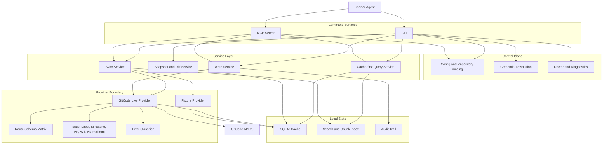

# Component Architecture

This document is the durable component form of the old generated design-package notes. It keeps the architecture and component responsibilities, but drops iteration scaffolding, task ledgers, generated validations, and historical package metadata.

## Runtime Shape

## Component Catalog

| Component | Code Area | Responsibility | Durable Contract |
|---|---|---|---|
| CLI | `cmd/gitcode-mcp/`, `internal/cli/` | Parses commands, resolves startup options, routes reads, sync, writes, config, auth, doctor, and cache commands. | Cache reads remain offline; GitCode-touching lifecycle commands use live provider by default unless `--offline`, `--fixture`, or write `--dry-run` is explicit. |
| MCP server | `internal/mcp/` | Exposes cache-first read tools, sync lifecycle tools, and configured write lifecycle tools to agents. | Tool availability is policy-driven. Write tools use the same service paths as CLI writes. |
| Capability registry | `internal/capability/` | Declares shared operation metadata, surface availability, safety class, and explicit CLI-only/MCP-only exceptions. | New write capabilities should be added through the registry; dangerous or intentionally asymmetric surfaces require a reason and tests. |
| Service layer | `internal/service/` | Owns command use cases, cache orchestration, sync graph commits, write confirmations, snapshots, diffs, and link checks. | Business behavior lives here rather than inside CLI or MCP transports. |
| Repository binding | `internal/config/`, `internal/service/` | Maps a stable repo id to owner, repo name, scopes, aliases, API base URL, and cache configuration. | Repository id is the local routing key. Remote ids are aliases, not replacements. |
| Credential resolution | `internal/auth/`, `internal/credential/`, `internal/config/` | Resolves environment and credential-store tokens and reports redacted status. | Tokens never enter logs, docs, fixtures, snapshots, or MCP responses. Missing credentials fail closed for live mode. |
| Doctor and diagnostics | `internal/doctor/`, `internal/diagnostics/` | Reports effective runtime state and normalized failure classes. | Diagnostics are typed and public-safe; raw API bodies and secret material are redacted. |
| Cache store | `internal/cache/` | Persists sources, identities, links, comments, chunks, revisions, sync events, locks, and schema migrations. | Reads are cache-first. Schema versioning and WAL keep routine reads deterministic and concurrent. |
| Repository documentation RAG | `internal/repositorydocs/`, metadata tables in `internal/cache/` | Resolves committed corpus policy, reads exact local Git objects, chunks in memory, publishes immutable revision sets/vectors, and hydrates verified citations. | Git is the only document-byte authority; aliases canonicalize before writes; no fetch and no persistent source/chunk text. |
| Maintenance identity resolution | `internal/servicectl/maintenance.go`, `maintenance_conflicts.go`, Admin controls | Canonicalizes aliases, preserves lossless conflict candidates, renders a generation-fenced selection plan, then atomically promotes one repository authority or one complete physical clone-path cohort behind a cache-writer admission fence. | Distinct repositories never merge across a clone; public surfaces receive paired hashes/fingerprints only; cache paths, repository paths, and config snapshots remain daemon-private. |
| Maintenance coordinator | `internal/servicectl/` | Owns the per-user managed-cache registry, identity validation, head/tail scheduling, job coalescing, and sanitized lifecycle status. | Raw cache paths stay daemon-local; scheduling keys include durable cache UUID and repository. |
| Bounded observation foundations | `internal/observability/` | Keeps catalog-only events and volatile fixed-cardinality metric samples separate from execution authority. | Recording never waits for disk, network, a probe or a telemetry reader; loss and unavailable probes remain explicit. Full transport/UI rollout is a separate cohort. |
| Indexer | `internal/index/` | Parses markdown, headings, stable ids, links, anchors, chunks, and freshness state. | Indexed chunks carry provenance and citations needed by CLI/MCP reads and snapshots. |
| GitCode provider boundary | `internal/gitcode/` | Defines provider interfaces, fixture behavior, live HTTP adapter, API models, route matrix, pagination, and write confirmation. | Live API shape decisions stay behind this adapter. Fixture mode remains deterministic and network-free. |
| Route schema matrix | `internal/gitcode/route_schema_matrix.go` | Declares supported, deferred, and unsupported route families by product area. | Unsupported or deferred capabilities return explicit diagnostics instead of empty success. |
| Normalizers | `internal/gitcode/*normalizer*.go`, provider model code | Converts GitCode issue, label, milestone, push mirror, pull request, comment, and wiki shapes into cache/service records. | GitCode-specific field quirks and push-mirror credential redaction are handled here, not scattered through transports. |
| Wiki provider | `internal/gitcode/http_client.go` | Traverses `{repo}.wiki` through `/contents`, reads `/raw`, and writes wiki pages through base64 content plus `sha` semantics. | Wiki uses token-compatible API v5 repository routes, not browser-session `web-api` routes. |
| Error classifier | `internal/gitcode/errors.go`, `internal/diagnostics/` | Separates API validation, schema decode, credential/config, transport, rate-limit, and unsupported capability failures. | 4xx API failures, malformed JSON, and network failures must not collapse into generic internal errors. |
| Audit trail | `internal/audit/`, `internal/service/` | Records non-secret write confirmations and idempotency evidence. | Writes are reviewable and replay-safe without storing tokens or raw private payloads. |
| Feedback readiness and setup | `internal/feedback/`, `internal/config/feedback_setup.go`, CLI/MCP/Admin transports | Separates always-available report preparation from submission readiness. Build metadata owns the destination; Admin exposes it read-only with prerequisites and configuration-conflict diagnostics. | Discovery is side-effect-free. Legacy CLI setup enables only the already-bound build destination; matching legacy configuration is accepted, conflicts block submission. Downstream retargeting is build-time only. |
| Test network harness | `internal/testnet/`, package tests, `docs/test-architecture.md` | Provides offline HTTP-compatible test surfaces for live-provider behavior and keeps unit, offline integration, fixture, and live E2E boundaries explicit. | `go test ./...` must pass without real network, credentials, Keychain, or SSH agent. |

## Primary Flows

### Cache-First Read

1. CLI or MCP receives a read request.
2. Repository binding resolves the local repo id.
3. Service layer reads SQLite records, links, chunks, and identities.
4. CLI or MCP returns sanitized records without contacting GitCode.

### Live Sync

1. Caller runs a GitCode-touching lifecycle command; `--live` is accepted as a compatibility alias, while `--offline`/`--fixture` select deterministic fixture mode.
2. Credential and repository binding are resolved before HTTP work starts.
3. Live provider fetches selected collections through GitCode API v5.
4. Normalizers convert remote records into cache graphs.
5. Service layer commits records, comments, identities, links, revisions, and sync events.
6. Index refresh derives chunks and link state for later offline reads.

### Explicit Write

1. Caller invokes a write command or enabled MCP write tool.
2. Service layer validates repo scope, write mode, idempotency, and required fields.
3. Live provider performs the GitCode API call and confirms the remote result. For issue updates it first supplies the canonical preimage to the service's durable claim callback; a changed previously claimed preimage fails before PATCH.
4. Service layer writes audit evidence and updates cache state.
5. CLI or MCP returns a sanitized confirmation. Ambiguous issue-update recovery is GET-only and returns `recovered_after_ambiguous_write` only when requested and preserved-field invariants match.

### Snapshot And Diff

1. Service layer reads cache sources, identities, links, chunks, and revisions.
2. Snapshot export sorts records deterministically.
3. Diff compares two snapshots without live access.
4. Output is safe to review and commit when it uses placeholder data.

## Boundary Rules

- CLI and MCP are transports. Shared behavior belongs in `internal/service/`.
- The daemon publishes its private runtime identity and compatibility PID file
  through same-directory atomic replacement. A reader sees a complete old or
  new document, never a truncate-in-place intermediate. Runtime state remains
  authoritative; the two files are not a cross-file transaction. Malformed
  persistent state is still an error, not silently retried or treated as healthy.
- Live API quirks belong in `internal/gitcode/`, guarded by tests and route-schema evidence.
- Cache migrations must be explicit and versioned. Routine reads should not take the writer lock when the schema is current.
- Writes are never implicit background side effects of reads.
- GitCode wiki files should use explicit `.md` paths for durable pages.
- Historical design-package evidence belongs in git history or wiki summaries, not in main.

## Related Docs

### Metric evidence foundation

The metric catalog is machine-readable and closed: there is no arbitrary
registration or label API. Dimensions are finite product enums for work kind,
collection, outcome and Admin route class; job, request, cache and repository
identities belong in typed event correlation, never in metric labels.
The foundation does not itself expose new CLI/MCP/Admin endpoints or claim that
the complete observability cohort is ready. Execution hooks, incident projection
and the shared transport/UI rollout have independent integration gates.

Gauges have a 15-second sampling window. Runtime probes report uptime in seconds,
heap allocation in bytes, goroutines as a count and the last observed GC pause
in seconds; no GC observation is unavailable, not a zero pause. Execution probes
supply queued/active jobs, writer waiters, scheduled retries and SSE connections.
Absent, invalid or failed probes produce `value: null` and a fixed reason.
Counters and duration histograms reset at boot and remain unavailable until
their trusted origin is attached. Snapshot `boot_id` and `reset_at` identify
that boundary. Histogram boundaries are 0.01, 0.05, 0.1, 0.5, 1, 5, 15, 60, 300
and 1800 seconds, plus one overflow cell. Distribution cells are non-cumulative;
`count` and `sum` describe the per-boot duration distribution, not proof of work.

History is a fixed ring of 60 UTC one-minute buckets, sampled in distinct UTC
15-second slots. Gauge/counter count, sum and extrema summarize sampled values.
Counter delta sums valid adjacent-sample increments; rate is the latest valid
adjacent-sample increment per second, not a cross-boot or whole-minute rate.
Histogram history aggregates observed duration count/sum/extrema between
adjacent samples, assigned to the ending sample's UTC bucket. A sampling gap
does not attribute an arbitrarily long duration interval to the newest minute.
Current per-boot totals remain available separately. Missing buckets,
pre-boot history, unavailable probes and baseline/reset boundaries remain
explicit, without invented zeros. A complete bucket requires all four distinct
slots and no missing baseline/probe/loss evidence. The current in-progress
bucket may be incomplete without being an execution failure.

Instrumentation uses bounded `TryLock` recording and never invokes a supplied
callback. Telemetry contention or invalid input increments a loss counter and
makes the snapshot partial; it cannot change execution results. Sampling probes
run only on a separate cancellation-aware worker. A stalled probe does not block
recording or snapshot reads, and shutdown cannot certify that worker as joined
until it actually exits. Returned catalog, labels, buckets and distribution
arrays are independent copies, not mutable references to the live registry.

- [Architecture](architecture.md)
- [Cache And Sync Model](cache-and-sync-model.md)
- [GitCode API Discovery](gitcode-api-discovery.md)
- [MCP Setup](mcp-setup.md)
- [PR/MR Workflow](pr-mr-workflow.md)
- [Sanitization Rules](sanitization.md)
