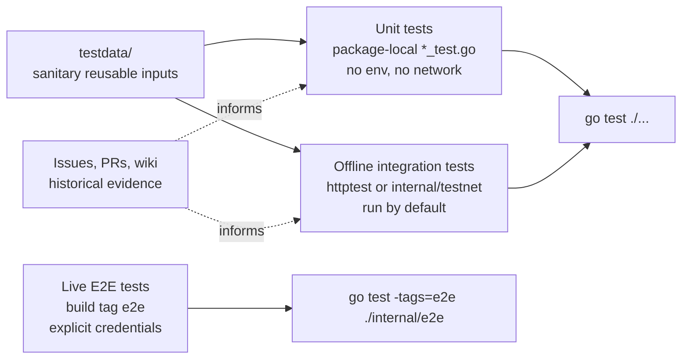

# Test Architecture

This repository keeps tests close to the code they verify. Do not add generated
design packages, captured work logs, or ad hoc harness dumps to `main`; keep
historical evidence in GitCode issues, pull requests, or wiki pages.

For the migration record of the old generated `tests/design_package` tree, see
`docs/test-intent-migration.md`.

## Test Categories



| Category | Location | Default run | Rules |
| --- | --- | --- | --- |
| Unit tests | Next to the package under `cmd/` or `internal/` | Yes | No live network, credentials, Keychain, SSH agent, or machine-local paths. Use package fakes and `t.TempDir()`. |
| Offline integration tests | Package-local tests using `httptest`, `internal/testnet`, temp SQLite caches, or CLI/MCP entrypoints | Yes | May exercise multiple packages, but must remain loopback-only and deterministic. |
| Live E2E tests | `internal/e2e/` | No | Must use `//go:build e2e`, explicit environment variables, redacted logs, and skip when credentials are absent. |
| Opt-in local benchmarks | Package-local `_test.go` harnesses guarded by an explicit environment variable | No | Use public-safe synthetic inputs, no credentials, bounded defaults, and report machine/model metadata needed to interpret results. Keep generated reports out of `main`. |
| Opt-in native service qualification | Package-local tests with unique fixture launchd/user-systemd owners | No; explicit Linux CI gate | Reset the child environment, use isolated offline configuration, reject unexpected platform commands, bound/redact diagnostics, and join/unlink the exact fixture owner. An explicitly requested run fails if its native bus is unavailable. See [native upgrade qualification](daemon-observation.md#native-owner-upgrade-qualification). |
| Fixture inputs | `testdata/` | Indirectly | Store only sanitized reusable inputs. Do not store generated design artifacts or raw API captures. |
| Historical evidence | GitCode wiki, issue comments, PR reports, git history | No | Use for research, dogfood notes, decisions, and exploratory output that should remain discoverable without living in `main`. |

## Naming Rules

- Prefer package-local `_test.go` files over a top-level `tests/` directory for
  Go behavior.
- Name reusable HTTP fakes by behavior, such as `mock_gitcode_api_test.go`, and
  keep them in the package that owns the surface they verify unless another
  package needs the same helper.
- Move reusable offline HTTP helpers to `internal/testnet` when more than one
  package can reasonably use them.
- Use neutral fixture names such as `offline-smoke`, `example-repo`, or
  `sanitized-*`. Avoid names that describe local dogfood history.
- Use `TestE2E...` only for live tests behind the `e2e` build tag.
- Use `TestIntegration...` only when a test crosses package or process
  boundaries; it still must be offline unless it also lives behind `e2e`.

## Live Test Contract

Live tests must be opt-in:

```sh
go test -tags=e2e ./internal/e2e
```

They must read credentials from explicit environment variables, redact tokens,
repository coordinates, and authorization headers from logs, and skip instead of
failing when the environment is not configured. The default suite must keep this
contract:

```sh
go test ./...
```

`go test ./...` must pass without network access, credentials, Keychain access,
or an SSH agent.

## Fixture Boundary

Fixtures are code inputs, not evidence archives. Before adding or changing a
fixture, check that it is:

- public-safe and sanitized;
- small enough to review in a pull request;
- reusable by a deterministic test;
- free of raw tokens, cookies, private repository names, internal URLs, and
  machine-local paths.

In-process daemon fixtures must distinguish listener readiness from startup
filesystem work. The empty CLI maintenance fixture waits for its complete initial
job snapshot before exposing the client, and registers an idempotent cancel/join
cleanup before readiness assertions. Fast rejection tests must not race startup
persistence against `t.TempDir()` removal. This is a test-harness barrier, not a
new production readiness condition.

Captured research, migration notes, dogfood reports, and generated design
packages belong in wiki pages or issue/PR comments when they are still useful.

Repository-document fixtures live under `testdata/repository-docs/` and contain
only public-safe committed policy/document examples. Tests create temporary Git
repositories for revision, rename, and tracked-worktree behavior and inspect
SQLite bytes for sentinels to prove that document text is not persisted.
Historical revision, offline full-text, overlay staleness, alias
canonicalization, daemon writer admission, resume/reuse, and deterministic
retention are package-level release gates. Retention tests must cover the
machine-local vector-byte ceiling, preserve the newest ready set under byte
pressure, and prove that membership, chunks, and vectors have no orphans after
GC. Maintenance tests register a private worktree, poll exact HEAD/policy
identity, enqueue only on change, recover the registration after daemon
restart, and assert that public JSON never contains the filesystem path.
Inspection-health fixtures also force registry write failure, an unrelated
later save/restart and independent provider-boundary admission rejection.
They prove that only confirmed inspection recovers its source cohort and that
generation/path replacement cannot publish a stale observation. Retry event
fixtures exercise the actual scheduler with resume, cancelled waits, failed
checkpoint writes and no metric sink; neither waiting nor replay alone counts
as an actual retry admission.
Durable journal reload followed by actual scheduler execution also covers the
last representable ordinal, an accepted over-catalog ordinal and an unknown
collection. The counter and execution result remain unchanged; qualified
omissions conserve ledger loss, including observation-only execution, without
inventing event rejection or poisoning metrics-only coverage. Context controls
check malformed scopes, nonblocking loss under a held collector lock, sealed
collectors and persisted loss after restart.
Writer-event fixtures exercise actual pre-admission, direct and retained resume
denials, a staged commit's typed lease failure and cancellation of its retry
wait. They assert opaque worker correlation versus fixed pre-job scopes,
optional metrics, no observation lookup of held job authority, wrapped typed
errors versus raw strings/fences, closed work-kind replay and content privacy.
Every actual boundary is retained or explicitly counted as lost; telemetry
rejection cannot retry or revive execution.
Stage-event fixtures exercise actual durable collection transitions and typed
writer denial/cancellation, idempotent retention across journal restart,
timestamp-only updates, failed create/state writes and scope mismatch. Strict
catalog/replay tests enforce stage-only opaque identity and finite outcomes.
One-turn tests hold the observation reader mutex, race Flush with late marks,
and prove a rejected confirmation is counted once without retry. Confirmation
never publishes while the coordinator owns its turn; private envelope bytes
and raw error sentinels must be absent from all retained event JSON.
Actual recovered SQLite commits also cover negative and over-catalog durable
attempts: execution and the original ordinal remain unchanged, no fabricated
stage event is emitted, and each omitted confirmed transition is counted as
partial coverage. Buffered-omission tests reject mismatched scopes, defer loss
until release, race duplicate/late flushes, and verify restart persistence.
Recovery-event fixtures reload real job snapshots and exercise actual sync and
repository-documentation resume, receipt/checkpoint terminal reconciliation and
group rejection. Repeated/missing/stale/fenced decisions and generic projections
emit no new boundary. Failed retained resume records loss while rolled-back
resume/rejection emits nothing. Fixed-cap group capture is qualified using a
supported retention policy larger than 128 jobs and paginated event reads,
conserving retained plus lost boundaries without fabricating admission,
terminal execution, provider or commit counters. Closed replay, reader-lock
contention, count-only metric loss and durable loss-restart tests enforce the
same nonblocking/public-safe contracts independently of optional metrics.
Maintenance registration fixtures use real cache bindings, registry saves and
Admin receipt-wrapped disable, covering new/replayed enrollment, unchanged
reconcile/timestamp projections, schema block/recovery, retained failed save
versus rollback, and rename-success/readback confirmation. A blocked actual
save and nested outer-lock boundary prove no early event. Fixed 128-item capture
conserves overflow using bounded cursor continuation instead of enlarged page
limits; metrics-only mode reports unconfirmed persistence without inventing
disabled event-queue loss. Strict replay rejects raw states/classes and other
execution dimensions; primitive identity, config/key/error sentinels stay out
of diagnostics, and registry restart emits no fresh transition.
Repository-document source fixtures exercise real Git source registration,
replay, distinct sources and generation-only versus degraded-state rebind reset.
Actual inspection failure/recovery and indexing state owners preserve separate
inspection health. Failed registration rolls back without diagnostic loss;
retained failed source writes report count-only loss, and exact atomic readback
confirms rename success without extra I/O. Source identity and finite classes
survive strict replay; paths, source ids, content and raw safe-looking error
classes remain excluded. Registration and source captures share one bounded
operation-local buffer and publication boundary.
Actual queued-job/rebind/fence and reconcile-snapshot/late-scheduling-failure
fixtures pair obsolete owners with current-generation controls. Obsolete
completion and failure callbacks must preserve the entire replacement authority
and scheduling state, perform zero registry writes, and manufacture neither a
transition nor diagnostic loss. Current controls still apply normally. Restart
readback qualifies the exact existing source redirect and retains every other
source field. A deterministic registration/cache/repository/source/path/profile
mismatch matrix and active-job intent controls fence unrelated work. The held
generation-fence test waits for an
accepted FIFO collector marker after registry save/unlock before asserting no
early maintenance publication; releasing the real fence conserves the transition.
Identity-resolution fixtures apply real legacy registry conflicts and physical
SQLite clones through the existing Plan/Apply owners. They cover enabled/disabled
Admin selection, stale plans, durable replay/restart, rollback/retry, panic before
confirmation and exact atomic readback without additional writes. Earlier actual
registration/source evidence survives a failed attempt. Multi-repository results
are qualified after canonicalization, including residual identity conflicts and
unresolved, timeout or config-snapshot-blocked results. An actual held job-redirect
mutex, active cache mutation fence and persisted FIFO marker prove publication
waits for authority unwind. Mixed-scope fixed capacity conserves qualified loss;
unchanged pairs add none, unsupported changed pairs fabricate no success, and
metrics-only mode invents no disabled event-stream loss. Later confirmed conflict
episodes with the same predecessor receive distinct operation correlations.
Closed replay enforces scope-specific predecessor/result enums and opaque
historical predecessor identity, which never leaks into worker context or other
event codes. Private candidate/plan/key/config/path coordinates stay excluded.
Admin request fixtures use actual mux/authenticated control and SSE paths, with
collector-only and combined metric modes. They conserve retained plus lost
completions, preserve panic/write/short-write/flush/cancellation outcomes and
streaming support, and wait for an active handler to unwind before recording
completion. Strict replay rejects Admin dimensions on other events and every
entity/private field on HTTP completions. Concurrent request correlation is
collector-owned across controllers and never waits for a reader; restart
preserves original events without replaying job/provider/commit throughput.
Registered observability polling emits no self-events; unsupported/user-prefix
paths remain observable ordinary requests. Synthetic control, cookie, body,
header, request-id and URL sentinels must be absent from retained evidence.
Admin invalidation ordering holds the actual append boundary and controls an
internal post-publication wait. It asserts exact one-second wait intent, one
compact UTC event per released interval and owned cancellation/joining, without
subtracting adjustable UTC timestamps. The product default remains a fresh
cancellable timer after publication; no fixed-ticker burst or timing tolerance.
Shared observation qualification uses actual private TCP IPC plus CLI, stdio,
normal/minimal HTTP/SSE, and authenticated Admin routes. Tests reject malformed
arguments before connection/retained reads, hold actual snapshot locks, cancel
silent established peers, fence whole-filter cursors, and compare serialized
DTOs including full sampled 60-minute metric windows above 64 KiB. IPC pipeline
framing and shutdown-handler joining are explicit invariants. Recovery
fixtures distinguish a missing commit observation from a failed durable commit:
the O5 recovery cohort still requires correlated admission/provider/terminal
events and actual job/cache/health success. A missing commit event is acceptable
only on a complete retained page with partial observation-contention coverage
and increased dropped/loss counters since that recovery phase began. Earlier
loss, unrelated loss reasons, unknown/ready coverage, truncation and sibling or
prior-boot events cannot substitute for evidence. Held-reader-lock fixtures
confirm that one deferred commit rejection is counted once, never retried, and
survives collector restart. Entrypoint fault
fixtures cover missing/damaged/old/future/cache-parent state and actual adapter
construction failure: discovery and observation do not create/migrate the cache
or resolve credentials. Later explicit live writes use offline HTTP fixtures to
prove provider confirmation, audit, and one POST on idempotent replay; absent
credentials/offline requests fail closed rather than selecting fixture writes.
Sync attempt-evidence fixtures cancel or expire contexts before dispatch,
cancel rate-limit waits from their explicit callback, and inject failures at
`RoundTrip` entry rather than racing a whole-command millisecond deadline.
They distinguish zero-entry operation interruption from entered-transport
failure, retain an empty successful list before later cancellation, freeze
operation-local evidence independently of telemetry, and preserve typed error
unwraps and partial aggregation. CLI text/JSON and MCP structured diagnostics
must agree. Adapter tests preserve configured timeout and redirect policy.
Actual shared-service multi-collection controls succeed on the first issues
list, cancel the later PR request from its local rate-limit callback, and retain
overall HTTP evidence without classifying the unentered request as a transport
failure. Failed-request receipts have separate mixed-cause and unknown-branch
controls; prior confirmed provider/schema failures retain precedence.
Target-batch controls also confirm that already-cancelled tail targets carry
explicit skipped-before-dispatch evidence, while genuinely unknown failures
remain unknown. Earlier successful targets and their HTTP receipts are retained.
Actual parent-context cancellation at transport entry is exercised separately
for bounded issues, wiki, and PR synchronization, with successful-empty-read
controls. CLI/MCP exercise the same cancellation boundary. Private typed causes
survive queue-summary failures and nested collection aggregation without adding
public failure counts, serializing cause text, or retaining aggregate cycles.
Safe-copy fixtures accept only returned catalog/incident evidence, reject raw
free-form reasons, and preserve omitted unknown authority references. The
dedicated UI and integrated rollout remain separately qualified cohorts; see
[Daemon observation](daemon-observation.md).
Maintenance identity tests also enroll canonical and alias repository ids
concurrently, migrate compatible and conflicting version-1 registry entries,
project legacy registration/job references to the canonical identity, preserve
failed-stage retry evidence without reviving superseded failures, and prove
that genuinely different repositories in one cache remain separate. Admin
browser coverage gates conflict plan/confirm, legacy deep-link redirect, and
recovery before the canonical-identity UX cohort is considered complete.
Browser CI is semantic-only: assert DOM roles/text, ARIA state, API JSON,
status/count values, navigation, and action outcomes. Screenshot capture,
reference composition, and pixel baselines are local opt-in QA and must be
disabled whenever `CI` is set, even if their local environment variables leak
into the runner. Playwright trace capture is also disabled in CI because its
archive embeds raster screenshots. A pure configuration unit test feeds every
local visual-QA variable into the CI policy and asserts that output/reference
paths and pixel baselines are disabled and trace mode is `off`; it generates
and compares no raster artifact. After the browser suite, CI also scans its
result directories and fails if any raster image, video, or Playwright trace
archive was produced, including by a test that bypassed the shared policy.

## Before Committing

Run:

```sh
go test ./...
git diff --check
```

For changes that touch live E2E behavior, also run or explicitly report why you
could not run:

```sh
go test -tags=e2e ./internal/e2e
```
