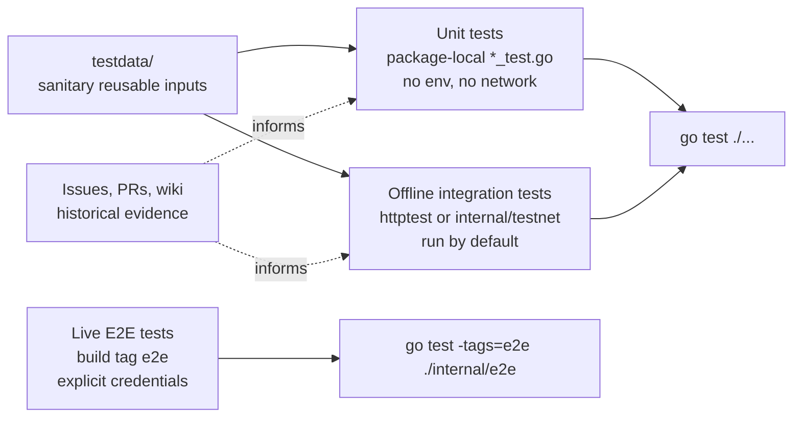

# Test Architecture

Native local-project observation uses a memory-only closed relay in the strict
child and the real retained collector in its trusted parent. Deterministic
tests cover the 64-record bound, loss saturation/seal, foreign/replayed/invalid
frames, actual startup-deadline handoff, disconnect and joined owner shutdown.
`TestNativeProductObservedSourceRetainedAcrossRestartAndReplay` builds the real
offline product, commits through private IPC, joins child/reader/collector,
reloads the actual parent ledger, and verifies original-key replay adds no
throughput. `TestNativeObservedProcessCloseJoinsRetainedReader` separately uses
the production parent process supervisor. The explicit Linux strict-network
qualification now enrolls retained observation, verifies the real commit event
and traces the new child graph; memory-only events are not durable-delivery
acceptance. Current-owner health and other L4 qualification gates remain
separate, not inferred from these tests.

This repository keeps tests close to the code they verify. Do not add generated
design packages, captured work logs, or ad hoc harness dumps to `main`; keep
historical evidence in GitCode issues, pull requests, or wiki pages.

For the migration record of the old generated `tests/design_package` tree, see
`docs/test-intent-migration.md`.

## Test Categories



| Category | Location | Default run | Rules |
| --- | --- | --- | --- |
| Unit tests | Next to the package under `cmd/` or `internal/` | Yes | No live network, credentials, Keychain, SSH agent, or machine-local paths. Use package fakes and `t.TempDir()`. |
| Offline integration tests | Package-local tests using `httptest`, `internal/testnet`, temp SQLite caches, or CLI/MCP entrypoints | Yes | May exercise multiple packages, but must remain loopback-only and deterministic. |
| Live E2E tests | `internal/e2e/` | No | Must use `//go:build e2e`, explicit environment variables, redacted logs, and skip when credentials are absent. |
| Opt-in local benchmarks | Package-local `_test.go` harnesses guarded by an explicit environment variable | No | Use public-safe synthetic inputs, no credentials, bounded defaults, and report machine/model metadata needed to interpret results. Keep generated reports out of `main`. |
| Opt-in native service qualification | Package-local tests with unique fixture launchd/user-systemd owners | No; explicit Linux CI gate | Reset the child environment, use isolated offline configuration, reject unexpected platform commands, bound/redact diagnostics, and join/unlink the exact fixture owner. An explicitly requested run fails if its native bus is unavailable. See [native upgrade qualification](daemon-observation.md#native-owner-upgrade-qualification). |
| Fixture inputs | `testdata/` | Indirectly | Store only sanitized reusable inputs. Do not store generated design artifacts or raw API captures. |
| Historical evidence | GitCode wiki, issue comments, PR reports, git history | No | Use for research, dogfood notes, decisions, and exploratory output that should remain discoverable without living in `main`. |

## Naming Rules

- Prefer package-local `_test.go` files over a top-level `tests/` directory for
  Go behavior.
- Name reusable HTTP fakes by behavior, such as `mock_gitcode_api_test.go`, and
  keep them in the package that owns the surface they verify unless another
  package needs the same helper.
- Move reusable offline HTTP helpers to `internal/testnet` when more than one
  package can reasonably use them.
- Use neutral fixture names such as `offline-smoke`, `example-repo`, or
  `sanitized-*`. Avoid names that describe local dogfood history.
- Use `TestE2E...` only for live tests behind the `e2e` build tag.
- Use `TestIntegration...` only when a test crosses package or process
  boundaries; it still must be offline unless it also lives behind `e2e`.

## Live Test Contract

Live tests must be opt-in:

```sh
go test -tags=e2e ./internal/e2e
```

They must read credentials from explicit environment variables, redact tokens,
repository coordinates, and authorization headers from logs, and skip instead of
failing when the environment is not configured. The default suite must keep this
contract:

```sh
go test ./...
```

`go test ./...` must pass without network access, credentials, Keychain access,
or an SSH agent.

The CI Go gate runs the same fixed `go test ./...` command through
`python3 scripts/ci/run_go_tests.py`. Python's `close_fds=True` isolates the Go
test host from ambient hosted-runner descriptors while preserving standard
input/output/error, environment, working directory, and nonzero exit status.
Run its deterministic controls with
`python3 -m unittest discover -s scripts/ci -p 'test_*.py'`. Deliberately inherited
pipes are visible in the dirty control, absent in the clean child, and remain
open and inheritable in the parent. Signal termination stays a nonzero failure.
This boundary does not sanitize a product process or qualify native isolation:
authority tests create their deliberate unrelated-descriptor and socket-role
controls afterward, and production admission must still refuse them. A clean
test host is not evidence for network, credential, or foreign-user isolation.

## Fixture Boundary

Knowledge-status interruption controls cancel or expire a real caller context
at actual initial-layout, settled-history and final-ref checkpoints. They require
prompt traversal termination without a corruption verdict, publication barrier,
source-sequence/ref change or loss of the original canonical receipt. Separate
Git-damage, SQL-corruption, capacity and legacy-readiness controls retain their
existing classifications; interruption is not evidence that damaged data healed.

Fixtures are code inputs, not evidence archives. Before adding or changing a
fixture, check that it is:

- public-safe and sanitized;
- small enough to review in a pull request;
- reusable by a deterministic test;
- free of raw tokens, cookies, private repository names, internal URLs, and
  machine-local paths.

In-process daemon fixtures must distinguish listener readiness from startup
filesystem work. The empty CLI maintenance fixture waits for its complete initial
job snapshot before exposing the client, and registers an idempotent cancel/join
cleanup before readiness assertions. Fast rejection tests must not race startup
persistence against `t.TempDir()` removal. This is a test-harness barrier, not a
new production readiness condition.

Captured research, migration notes, dogfood reports, and generated design
packages belong in wiki pages or issue/PR comments when they are still useful.

Local-authority recovery job fixtures separate durable metadata admission from
actual source effects. They cover exact original receipt identity, cancellation
without the worker-held effect turn, before/after-rename cancellation failure,
stale attempt-generation signals, restart of queued/running/cancelling/cancelled
intent, proof-only reconciliation after the original caller settles, and
terminal metadata acknowledgement failure without another source operation.
Actual background-worker controls verify reconciliation without manual retry;
deterministic lock-release windows verify that waiters cannot miss a release.
Bounded child-process FIFO controls reject both final and stage nonregular files
without hanging startup. Metadata fault/type/inode/content controls preserve
uncertain evidence and prove that intact tracker operations remain available.
Pages are observation-only, clone receipts and reject changed generation/digest
cursors. These offline tests are not full native launch/network qualification.

The recovery private-IPC cohort also exercises actual Unix admission, durable
queued cancellation, retained replay, generation-CAS retry, real background
recovery and original-source receipt replay. Augmented test-only fixtures defer
workers around deterministic queued controls; no production fault/path
constructor is exported. Malformed peer fixtures prove that old/incomplete
capabilities prevent operation dispatch and that forged, unrelated or extra
selector responses are rejected even with a discarded result destination.
Result snapshots replace, rather than patch, a caller's previous object;
omitted fields clear and invalid responses leave the original object intact.

Local projection catalog tests consume actual prepared writer ownership and
canonical SQLite/Git snapshot pages. They distinguish a new citation with the
same content digest from a real edit, new entity, archive or tombstone. An
explicit as-of origin and changed/future continuation controls prevent snapshot
mixing. Persisted final/staged files must omit synthetic document/title/key
sentinels, while old canonical Git citations remain readable. Publication fault
controls exercise before/after rename cancellation and preserve source sequence,
readiness and original receipts. Failed namespace-parent synchronization must
be retried before publication acknowledgement. Reopen after rename uncertainty
must synchronize final file, namespace and parent; failure/cancellation at every
barrier refuses admission while preserving final bytes and canonical reads.
Ordinary metadata views do not repeat writer-admission barriers.
Metadata view cloning, late generation CAS,
bounded preserved orphan stages and capacity failure are tested separately.
The builder's production capacity is fixed; a private smaller fixture limit
exercises the same failed-prefix branch on real source rows. Stored JSON above
the transport ceiling validates only the larger bounded file grammar; the
ordinary transport decoder must still refuse it. Actual child FIFO controls
prove final/stage type refusal cannot block, alongside symlink/hardlink/unknown
inventory and namespace/inode/content replacement controls. These domain tests
do not certify real hybrid vectors or complete native isolation.

Index-job tests use actual prepared authority, ledger publication and coordinator
workers. They qualify original caller identity, generation-fenced cancellation,
explicit retry, exact completed-build reconciliation, fixed as-of traversal with
a real source edit between two owned turns, and writer retention while a stalled
worker prevents shutdown join. Restart metadata qualification precedes dispatch
so deterministic DTO assertions do not race legitimate admission conflicts.
Before/after publication faults and every failed/cancelled reopen barrier retain
canonical reads/receipts and original ledger bytes. Actual child FIFO, unsafe
file/inventory and same-content inode/namespace replacements fail closed.
Missing final state and orphan capacity never silently initialize empty history.
Actual active-worker controls distinguish rejected cancellation from post-rename
ambiguity. Terminal-save failures before rename fence and reconcile the exact
completed catalog; inactive retry against another active job preserves bytes
and reports normal conflict. Completed-builder publication contention waits
without another attempt. Concurrent source identity revalidation and metadata
guards are race-qualified; valid-but-changed manifest policy cannot replace the
immutable admitted identity.
Actual completed-catalog controls hold ledger or projection locks beyond a
short private proof deadline: terminal exit remains bounded, controls seal
uncertainty without blocking, source/catalog remain intact, and verified reopen
reconciles the original build without another attempt.
Derived-repair planning tests use actual canonical stores/catalogs and original
index admission/cancellation/publication history. Missing/valid state is a
no-effect observation; corrupt known metadata gives a bounded quarantine
proposal, not a reset receipt. Tests reject FIFO/link/mode/unknown/oversize
inventory, preserve confirmed citations and caller/cancellation bytes, fence
content/inode/source/ledger changes and exclude timestamp-only metadata. Actual
queued intent and an unjoined attempt block planning; retained ambiguous
publication remains blocked across owner reopen. Cancellation, contention and
impossible result fields cannot authorize effects. These tests do not qualify
public repair transport rollout, which remains gated by its cohort acceptance.
The shared apply tests use genuine canonical/index publication followed by
corruption, bounded quarantine, original-key replay, qualified owner reopen and
explicit new indexing. A 22-cut matrix covers prepared/staged publication,
exclusive move, file/directory/root sync, readback and receipt acknowledgement.
At every cut original index-ledger bytes, canonical citation and real lexical
retrieval are preserved. Native no-replace collision, pending-key conflict,
stale image, cancellation/joined writer ownership, bounded history quota and
corrupt/unsafe repair/quarantine intake are deterministic offline regressions.
These do not substitute for CLI/MCP/Admin or real embedding acceptance; no user
provider or repository is used by the fixtures.
The repair private-IPC cohort exercises actual plan, interrupted acknowledgement,
atomic discovery, original-key replay, lookup, qualified owner reopen and
separate index admission. Canonical citations and real lexical fallback remain
unchanged. Shared missing/pending/missing-final fixtures prove history never
provisions metadata or invents empty evidence. Closed validators reject mixed,
duplicate, omitted, impossible-phase or replay-marked rows and conserve complete
count/generation/digest accounting. Authenticated malformed peers are rejected
even for discarded results; changed request keys/plans and pending apply replies
cannot claim confirmation, and old capability inventories receive no write.
These are protected repair integration tests, not complete native/runtime or
public CLI/MCP/Admin qualification.

The index private-IPC cohort validates exact caller-request admission digests,
typed unknown jobs, generation-fenced cancel/retry, missing-ledger observation,
bounded sorted pages and generation/digest/count/offset continuation. Real Unix
round trips preserve queued cancellation across owner reopen, explicitly retry
the original intent, execute one actual catalog build and retain honest hybrid
fallback. A same-binary native process publishes an actual catalog and reopens
its exact job identity without another attempt. Authenticated malformed-peer
fixtures reject forged project/job/digest/cursor/selector and false-action
responses even when discarded; finite errors omit peer prose. These tests do
not certify corrupt reset, semantic vectors, safe observation or full native
network isolation.

Local-project observation fixtures commit actual tracker and Git-only document
bytes through the shared coordinator, replay exact original keys across owner
reopen, and reject conflicted/unknown/cancelled requests. Actual source/document
acknowledgement loss retains proved commit evidence, pre-proof barrier faults
retain only count-based incomplete coverage, and precommit rollback emits none.
Pending original document intent records its first actual canonical publication
when resumed; settled replay never invents another. A qualification-only
collector idle window makes successful one-shot emission deterministic without
retrying writes or replacing the real queue/persistence. Another actual reader
holds the collector mutex while a canonical commit succeeds, proving counted
admission loss without changing receipt, readback or replay. Catalog/reload,
project-filter cursor, safe-copy and browser unit tests reject mixed remote
bridges and private input; event presence never invents current health. These
tests do not substitute for native retained delivery, all local phase coverage,
exact owner-state health or the later public workflow cohort.

Local phase fixtures run actual index/recovery workers and quarantine repair,
then replay original admissions/actions without inventing transitions. Nine
ledger cuts distinguish pre-rename failure, uncertain rename and confirmed
publication with lost acknowledgement. A real observation reader holds the
collector mutex during bounded capture: no emission/loss occurs under the
source turn, then release emits the bounded records with counted overflow.
Actual canonical commit proof also survives concurrent owner cancellation and
joined Close. Foreign/noncatalog capture and pre-admission cancellation are
rejected. Cancellation racing the actual rename retains possible-publication
coverage; a filesystem rename has no context-driven rollback guarantee. The finite
phase/outcome catalog is tested through ledger replay, filters, safe-copy and
semantic browser rendering without a remote navigation bridge. These are
shared-core controls, not native retained-delivery/current-health qualification.

Current-owner health controls use actual source/catalog/job/repair state, not
retained observations. They distinguish qualified source sequence zero from a
missing catalog and publication generation, preserve canonical/lexical reads
through derived damage, retain logical and repair-restart fences, and observe
an actual live index attempt separately from its published catalog. Protected
Unix controls reject wrong project/epoch, malformed or oversized DTOs even when
discarded, and old inventories before the operation. Actual native restart
changes the immutable epoch; live socket replacement by an echo responder is
rejected before contact and preserved on original-owner cleanup. Mutable generic
client coordinates cannot retarget the trusted health handle. These are
cooperating-user routing controls, not hostile same-UID impersonation proof.

Independent-review regressions require an actually unqualified SQLite writer
to stop reporting ready/owned, reject contradictory protected DTO combinations,
and expire serving proof when a real borrowed server stops while its owner
remains alive. Serving lease controls retain replacement admission until handler
join and prevent an old lease from clearing a later one. Restoring transient
durability settings must not require fabricated source recovery. The traced
strict product gate also performs the current-health read using its completed
preparation's retained expected epoch, not an epoch learned from a response.

The explicit Linux strict-process network gate builds the real product from
the current checkout with `python3 scripts/ci/run_native_authority_network.py`.
Direct opt-in tests may use a separately built artifact only with an explicit
SHA-256 byte identity; their output identifies those bytes, not their source.
Current-source evidence must include the exact build checkout/command as well
as the artifact identity (the fixed CI runner builds and hashes it itself).
It requires `/usr/bin/strace`, `/usr/bin/cc` for the bounded non-Go process-birth
control, and a durability-qualified fixture filesystem;
tmpfs and overlayfs are not substitutes for ext4/XFS/Btrfs. Its positive control
performs actual loopback TCP and fixture-owned UDP/DNS requests before checking
the strict native entry through private IPC mutate/read/search and joined stop.
The observer consumes a bounded transient stream (2 MiB total, 16 KiB per line),
retains only counters and completion flags, and counts failed socket attempts.
Missing, truncated, unknown or incomplete observation is a failure, not evidence
of zero network activity. Neither raw syscall output nor browser artifacts are
written or uploaded. The CI runner installs only this test observer; it does not
set up an embedding provider or the operator's canonical service. Default
offline tests skip the external observer explicitly; selecting this gate makes
an unavailable observer fatal. The fixed runner refuses non-Linux before build
rather than accepting a successful Go invocation with no matching Linux-only
tests. This Linux evidence does not qualify macOS, foreign-UID access or real
semantic retrieval. Immediate-close-after-launch
tests separately reacquire canonical ownership and restart without an extra IPC
readiness turn. No production lifetime fix is inferred merely from a hypothesis.
The observer requires strace's `--kill-on-exit` (6.6 or newer); missing support
fails rather than falling back to process-group cleanup. A real fixture child
escapes into a new session, then owned-tracer cancellation must make its pinned
pidfd report death. Strict observation includes process creation and refuses
non-thread delegation and `CLONE_UNTRACED`, not just extra executable entries.
A real C fixture creates and joins a `CLONE_UNTRACED` child with one inert INET
socket attempt; strict observation must reject its birth rather than silently
lose that descendant's calls. The compiler is test infrastructure only.
These [strace lifecycle semantics](https://github.com/strace/strace/blob/master/doc/strace.1.in)
are observer prerequisites, not product runtime dependencies.

Private server fixtures qualify an actual capability handshake before exposing
their listener to cancellation tests. A kernel backlog connect is not serving
readiness: a deterministic cancelled-before-Serve control preserves the cold
unavailable refusal. The existing 40 silent peers, 32-handler cap and actual
joined-shutdown checks remain unchanged; no sleep or timeout inflation replaces
the startup barrier. Failed-start cleanup still closes the caller-owned listener.
Independent record-count/wire-size/page-continuation controls and fixed typed
job errors preserve protected scope without echoing arbitrary peer content.
Malformed peer controls also reject false action acknowledgements, regressed
fresh admission, impossible generation/attempt history, truncated fresh pages,
wrong-digest final pages and resumed totals that silently shrink. Snapshot
digest/offset/seen/total claims are verified on every page, including empty or
terminal responses; they do not constitute cryptographic peer attestation.
Page/job versus snapshot-generation controls and metadata reopen controls also
reject impossible but otherwise bounded/digest-consistent history, preserving
the tampered sidecar and keeping intact tracker operations available.

Repository-document fixtures live under `testdata/repository-docs/` and contain
only public-safe committed policy/document examples. Tests create temporary Git
repositories for revision, rename, and tracked-worktree behavior and inspect
SQLite bytes for sentinels to prove that document text is not persisted.
Historical revision, offline full-text, overlay staleness, alias
canonicalization, daemon writer admission, resume/reuse, and deterministic
retention are package-level release gates. Retention tests must cover the
machine-local vector-byte ceiling, preserve the newest ready set under byte
pressure, and prove that membership, chunks, and vectors have no orphans after
GC. Maintenance tests register a private worktree, poll exact HEAD/policy
identity, enqueue only on change, recover the registration after daemon
restart, and assert that public JSON never contains the filesystem path.
Inspection-health fixtures also force registry write failure, an unrelated
later save/restart and independent provider-boundary admission rejection.
They prove that only confirmed inspection recovers its source cohort and that
generation/path replacement cannot publish a stale observation. Retry event
fixtures exercise the actual scheduler with resume, cancelled waits, failed
checkpoint writes and no metric sink; neither waiting nor replay alone counts
as an actual retry admission.
Durable journal reload followed by actual scheduler execution also covers the
last representable ordinal, an accepted over-catalog ordinal and an unknown
collection. The counter and execution result remain unchanged; qualified
omissions conserve ledger loss, including observation-only execution, without
inventing event rejection or poisoning metrics-only coverage. Context controls
check malformed scopes, nonblocking loss under a held collector lock, sealed
collectors and persisted loss after restart.
Writer-event fixtures exercise actual pre-admission, direct and retained resume
denials, a staged commit's typed lease failure and cancellation of its retry
wait. They assert opaque worker correlation versus fixed pre-job scopes,
optional metrics, no observation lookup of held job authority, wrapped typed
errors versus raw strings/fences, closed work-kind replay and content privacy.
Every actual boundary is retained or explicitly counted as lost; telemetry
rejection cannot retry or revive execution.
Stage-event fixtures exercise actual durable collection transitions and typed
writer denial/cancellation, idempotent retention across journal restart,
timestamp-only updates, failed create/state writes and scope mismatch. Strict
catalog/replay tests enforce stage-only opaque identity and finite outcomes.
One-turn tests hold the observation reader mutex, race Flush with late marks,
and prove a rejected confirmation is counted once without retry. Confirmation
never publishes while the coordinator owns its turn; private envelope bytes
and raw error sentinels must be absent from all retained event JSON.
Actual recovered SQLite commits also cover negative and over-catalog durable
attempts: execution and the original ordinal remain unchanged, no fabricated
stage event is emitted, and each omitted confirmed transition is counted as
partial coverage. Buffered-omission tests reject mismatched scopes, defer loss
until release, race duplicate/late flushes, and verify restart persistence.
Recovery-event fixtures reload real job snapshots and exercise actual sync and
repository-documentation resume, receipt/checkpoint terminal reconciliation and
group rejection. Repeated/missing/stale/fenced decisions and generic projections
emit no new boundary. Failed retained resume records loss while rolled-back
resume/rejection emits nothing. Fixed-cap group capture is qualified using a
supported retention policy larger than 128 jobs and paginated event reads,
conserving retained plus lost boundaries without fabricating admission,
terminal execution, provider or commit counters. Closed replay, reader-lock
contention, count-only metric loss and durable loss-restart tests enforce the
same nonblocking/public-safe contracts independently of optional metrics.
Maintenance registration fixtures use real cache bindings, registry saves and
Admin receipt-wrapped disable, covering new/replayed enrollment, unchanged
reconcile/timestamp projections, schema block/recovery, retained failed save
versus rollback, and rename-success/readback confirmation. A blocked actual
save and nested outer-lock boundary prove no early event. Fixed 128-item capture
conserves overflow using bounded cursor continuation instead of enlarged page
limits; metrics-only mode reports unconfirmed persistence without inventing
disabled event-queue loss. Strict replay rejects raw states/classes and other
execution dimensions; primitive identity, config/key/error sentinels stay out
of diagnostics, and registry restart emits no fresh transition.
Repository-document source fixtures exercise real Git source registration,
replay, distinct sources and generation-only versus degraded-state rebind reset.
Actual inspection failure/recovery and indexing state owners preserve separate
inspection health. Failed registration rolls back without diagnostic loss;
retained failed source writes report count-only loss, and exact atomic readback
confirms rename success without extra I/O. Source identity and finite classes
survive strict replay; paths, source ids, content and raw safe-looking error
classes remain excluded. Registration and source captures share one bounded
operation-local buffer and publication boundary.
Actual queued-job/rebind/fence and reconcile-snapshot/late-scheduling-failure
fixtures pair obsolete owners with current-generation controls. Obsolete
completion and failure callbacks must preserve the entire replacement authority
and scheduling state, perform zero registry writes, and manufacture neither a
transition nor diagnostic loss. Current controls still apply normally. Restart
readback qualifies the exact existing source redirect and retains every other
source field. A deterministic registration/cache/repository/source/path/profile
mismatch matrix and active-job intent controls fence unrelated work. The held
generation-fence test waits for an
accepted FIFO collector marker after registry save/unlock before asserting no
early maintenance publication; releasing the real fence conserves the transition.
Identity-resolution fixtures apply real legacy registry conflicts and physical
SQLite clones through the existing Plan/Apply owners. They cover enabled/disabled
Admin selection, stale plans, durable replay/restart, rollback/retry, panic before
confirmation and exact atomic readback without additional writes. Earlier actual
registration/source evidence survives a failed attempt. Multi-repository results
are qualified after canonicalization, including residual identity conflicts and
unresolved, timeout or config-snapshot-blocked results. An actual held job-redirect
mutex, active cache mutation fence and persisted FIFO marker prove publication
waits for authority unwind. Mixed-scope fixed capacity conserves qualified loss;
unchanged pairs add none, unsupported changed pairs fabricate no success, and
metrics-only mode invents no disabled event-stream loss. Later confirmed conflict
episodes with the same predecessor receive distinct operation correlations.
Closed replay enforces scope-specific predecessor/result enums and opaque
historical predecessor identity, which never leaks into worker context or other
event codes. Private candidate/plan/key/config/path coordinates stay excluded.
Admin request fixtures use actual mux/authenticated control and SSE paths, with
collector-only and combined metric modes. They conserve retained plus lost
completions, preserve panic/write/short-write/flush/cancellation outcomes and
streaming support, and wait for an active handler to unwind before recording
completion. Strict replay rejects Admin dimensions on other events and every
entity/private field on HTTP completions. Concurrent request correlation is
collector-owned across controllers and never waits for a reader; restart
preserves original events without replaying job/provider/commit throughput.
Registered observability polling emits no self-events; unsupported/user-prefix
paths remain observable ordinary requests. Synthetic control, cookie, body,
header, request-id and URL sentinels must be absent from retained evidence.
Admin invalidation ordering holds the actual append boundary and controls an
internal post-publication wait. It asserts exact one-second wait intent, one
compact UTC event per released interval and owned cancellation/joining, without
subtracting adjustable UTC timestamps. The product default remains a fresh
cancellable timer after publication; no fixed-ticker burst or timing tolerance.
Shared observation qualification uses actual private TCP IPC plus CLI, stdio,
normal/minimal HTTP/SSE, and authenticated Admin routes. Tests reject malformed
arguments before connection/retained reads, hold actual snapshot locks, cancel
silent established peers, fence whole-filter cursors, and compare serialized
DTOs including full sampled 60-minute metric windows above 64 KiB. IPC pipeline
framing and shutdown-handler joining are explicit invariants.
Collector startup is joined through the existing opted-in qualification writer
idle acknowledgement before exact cross-transport snapshots are taken. Coverage
leaving initializing is not that boundary: the fresh Boot append follows loaded
coverage, including on a same-ledger partial restart. A private append barrier
regression proves that ready coverage with only prior-boot events cannot satisfy
the acknowledgement. Disabled, storage-unavailable and sealed controls remain;
no product constructor opts into this scheduling seam.
Recovery fixtures distinguish a missing commit observation from a failed durable commit:
the O5 recovery cohort still requires correlated admission/provider/terminal
events and actual job/cache/health success. A missing commit event is acceptable
only on a complete retained page with partial observation-contention coverage
and increased dropped/loss counters since that recovery phase began. Earlier
loss, unrelated loss reasons, unknown/ready coverage, truncation and sibling or
prior-boot events cannot substitute for evidence. Held-reader-lock fixtures
confirm that one deferred commit rejection is counted once, never retried, and
survives collector restart.
The whole-footprint rotation sibling uses the same strict predicate after a
queryable fresh-boot barrier, with a new recovery-phase loss baseline. Bounded
sparse pagination preserves the final page's coverage and never treats an empty
continuation as completion. Recovery independently proves distinct provider
bytes, the same waiting-to-committed stage, one committed issues collection and
new commit/success timestamps; retained events cannot manufacture that proof.
Its strict mandatory chain is admitted through an explicit qualification-only
collector factory/window: the serial writer acknowledges an idle boundary, then
pauses without a mutex for at most ten seconds. Real one-shot Emit calls still
use the same bounded queue; the fixture makes no observation reads until worker
join and writer release. Close drains/persists those actual entries. Normal
constructors and all product config/transports leave the window disabled.
Default-disabled, exclusivity, queue-limit, pre-ack cancellation, deadline,
shutdown and idempotent resume controls qualify this test scheduling boundary;
caller release and automatic expiry/stop share one atomic terminal transition,
with deterministic overlap fixtures proving each winner remains immutable;
neither fabricated causal events nor producer wait/retry is permitted.
Entrypoint fault
fixtures cover missing/damaged/old/future/cache-parent state and actual adapter
construction failure: discovery and observation do not create/migrate the cache
or resolve credentials. Later explicit live writes use offline HTTP fixtures to
prove provider confirmation, audit, and one POST on idempotent replay; absent
credentials/offline requests fail closed rather than selecting fixture writes.
Sync attempt-evidence fixtures cancel or expire contexts before dispatch,
cancel rate-limit waits from their explicit callback, and inject failures at
`RoundTrip` entry rather than racing a whole-command millisecond deadline.
They distinguish zero-entry operation interruption from entered-transport
failure, retain an empty successful list before later cancellation, freeze
operation-local evidence independently of telemetry, and preserve typed error
unwraps and partial aggregation. CLI text/JSON and MCP structured diagnostics
must agree. Adapter tests preserve configured timeout and redirect policy.
Actual shared-service multi-collection controls succeed on the first issues
list, cancel the later PR request from its local rate-limit callback, and retain
overall HTTP evidence without classifying the unentered request as a transport
failure. Failed-request receipts have separate mixed-cause and unknown-branch
controls; prior confirmed provider/schema failures retain precedence.
Target-batch controls also confirm that already-cancelled tail targets carry
explicit skipped-before-dispatch evidence, while genuinely unknown failures
remain unknown. Earlier successful targets and their HTTP receipts are retained.
Actual parent-context cancellation at transport entry is exercised separately
for bounded issues, wiki, and PR synchronization, with successful-empty-read
controls. CLI/MCP exercise the same cancellation boundary. Private typed causes
survive queue-summary failures and nested collection aggregation without adding
public failure counts, serializing cause text, or retaining aggregate cycles.
Safe-copy fixtures accept only returned catalog/incident evidence, reject raw
free-form reasons, and preserve omitted unknown authority references. The
dedicated UI and integrated rollout remain separately qualified cohorts; see
[Daemon observation](daemon-observation.md).
Maintenance identity tests also enroll canonical and alias repository ids
concurrently, migrate compatible and conflicting version-1 registry entries,
project legacy registration/job references to the canonical identity, preserve
failed-stage retry evidence without reviving superseded failures, and prove
that genuinely different repositories in one cache remain separate. Admin
browser coverage gates conflict plan/confirm, legacy deep-link redirect, and
recovery before the canonical-identity UX cohort is considered complete.
Browser CI is semantic-only: assert DOM roles/text, ARIA state, API JSON,
status/count values, navigation, and action outcomes. Screenshot capture,
reference composition, and pixel baselines are local opt-in QA and must be
disabled whenever `CI` is set, even if their local environment variables leak
into the runner. Playwright trace capture is also disabled in CI because its
archive embeds raster screenshots. A pure configuration unit test feeds every
local visual-QA variable into the CI policy and asserts that output/reference
paths and pixel baselines are disabled and trace mode is `off`; it generates
and compares no raster artifact. After the browser suite, CI also scans its
result directories and fails if any raster image, video, or Playwright trace
archive was produced, including by a test that bypassed the shared policy.

## Before Committing

Run:

```sh
go test ./...
git diff --check
```

For changes that touch live E2E behavior, also run or explicitly report why you
could not run:

```sh
go test -tags=e2e ./internal/e2e
```
